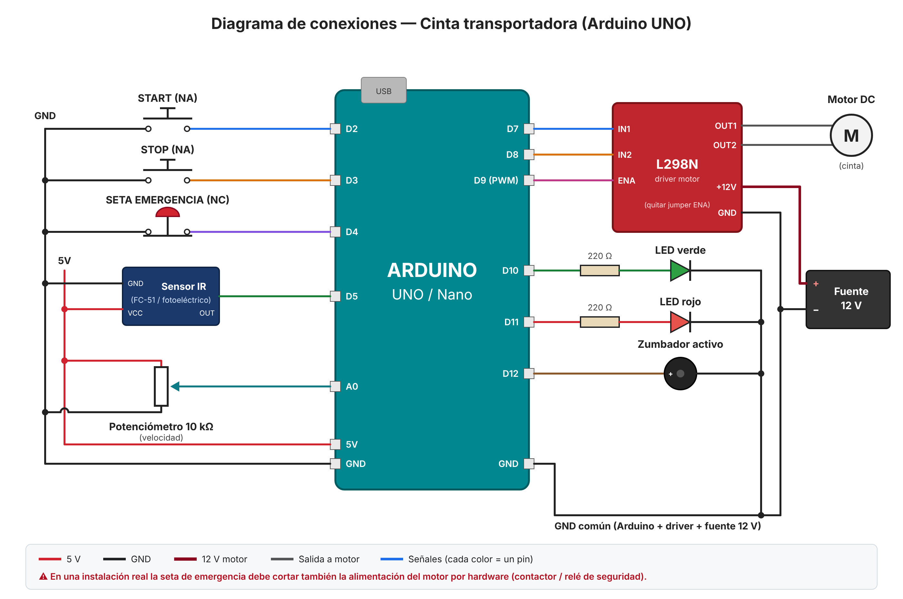

# Control de cinta transportadora con Arduino

Sketch: [`cinta_transportadora.ino`](cinta_transportadora.ino) (Arduino Uno / Nano).

## Conexionado

(Versión vectorial: [`diagrama_conexiones.svg`](diagrama_conexiones.svg))

| Elemento                       | Pin Arduino | Notas |
|--------------------------------|-------------|-------|
| Pulsador START (NA)            | D2          | Entre el pin y GND (usa pull-up interno) |
| Pulsador STOP (NA)             | D3          | Entre el pin y GND |
| Seta de emergencia (NC)        | D4          | Contacto NC entre el pin y GND. Si se pulsa **o se corta el cable**, para |
| Sensor de presencia (IR)       | D5          | Salida activa en LOW (p. ej. módulo FC-51 o fotoeléctrico NPN) |
| Driver motor IN1               | D7          | |
| Driver motor IN2               | D8          | |
| Driver motor ENA (PWM)         | D9          | Quitar el jumper ENA del L298N |
| LED verde (marcha)             | D10         | Con resistencia de 220 Ω |
| LED rojo (parada/fallo)        | D11         | Con resistencia de 220 Ω |
| Zumbador                       | D12         | Zumbador activo |
| Potenciómetro (velocidad)      | A0          | Extremos a 5V y GND, cursor a A0 |

**Alimentación:** el motor se alimenta desde la fuente del driver (12 V/24 V), nunca
desde el Arduino. Une siempre el GND de la fuente del motor con el GND del Arduino.

> ⚠️ **Seguridad:** la seta de emergencia por software es útil para un prototipo,
> pero en una cinta real la seta debe cortar también la alimentación del motor
> por hardware (contactor o relé de seguridad), independientemente del Arduino.

## Funcionamiento

- **START** arranca la cinta con un pitido de aviso y una rampa de aceleración (~1 s).
- **STOP** la detiene con rampa de deceleración.
- **Emergencia**: corta el motor al instante. Tras soltar la seta, pulsa START
  (o envía `reset`) para rearmar; la cinta queda parada hasta un nuevo START.
- **Sensor**: cuenta las piezas que llegan al final.
  - Modo `continuo`: solo cuenta.
  - Modo `pausa`: la cinta se para al llegar una pieza y reanuda al retirarla
    (o a los 5 s, configurable en `PAUSA_MAX_MS`).
- **Velocidad**: por potenciómetro, o fija por Serie.

LED verde fijo = en marcha · verde parpadeando = pausada ·
rojo fijo = parada · rojo parpadeando = emergencia.

## Comandos por Monitor Serie (115200 baudios, "Nueva línea")

| Comando                     | Acción |
|-----------------------------|--------|
| `start` / `stop`            | Arrancar / parar |
| `reset`                     | Rearmar tras emergencia |
| `estado`                    | Mostrar estado, velocidad y contador |
| `contador0`                 | Poner el contador de piezas a 0 |
| `vel 0`…`vel 100`           | Velocidad fija en % |
| `vel pot`                   | Volver a usar el potenciómetro |
| `modo continuo` / `modo pausa` | Cambiar de modo |
| `dir adelante` / `dir atras`   | Sentido de giro (solo con la cinta parada) |

## Ajustes

Al principio del sketch:

- `PWM_MINIMO`: PWM mínimo con el que tu motor arranca con carga. Súbelo si la
  cinta zumba pero no se mueve a velocidades bajas.
- `PASO_RAMPA` / `INTERVALO_RAMPA_MS`: suavidad de la rampa.
- `PAUSA_MAX_MS`: tiempo máximo de pausa en modo `pausa` (0 = esperar siempre
  a que se retire la pieza).
- Si tu sensor es activo en HIGH o usas un relé en lugar de un driver con PWM,
  hay que adaptar `flancoBajada()` / las funciones del motor.
